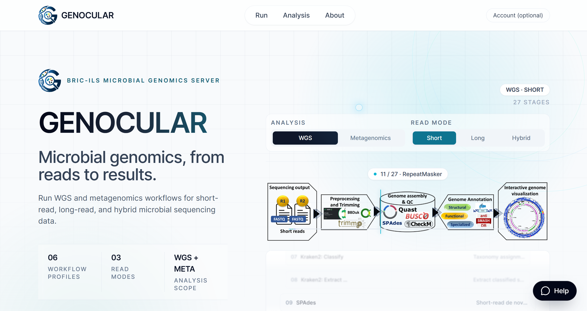
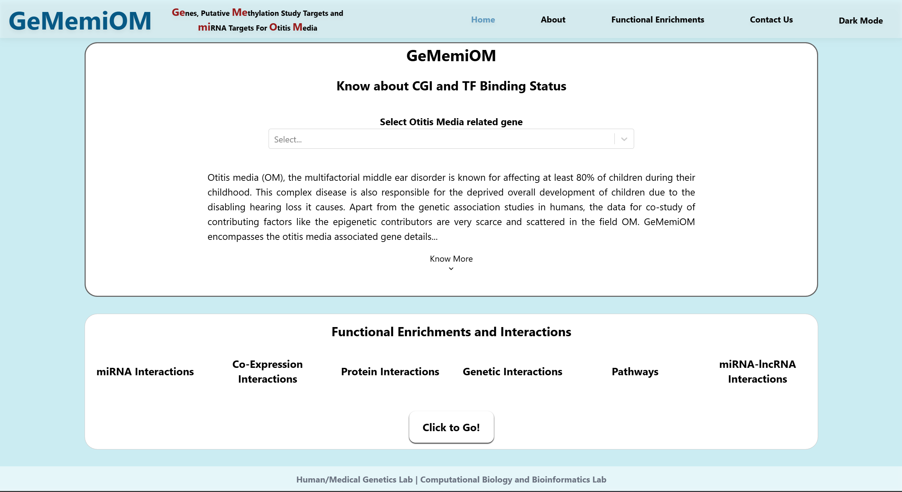
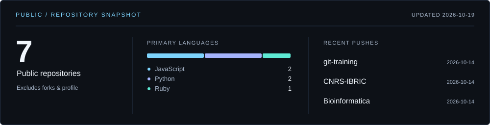

<picture>
  <source media="(max-width: 600px) and (prefers-reduced-motion: reduce)" srcset="assets/banner-mobile-still.svg" />
  <source media="(max-width: 600px)" srcset="assets/banner-mobile.svg" />
  <source media="(prefers-reduced-motion: reduce)" srcset="assets/banner-still.svg" />
  
</picture>

**Senior Research Fellow (Ph.D.) · Computational Biology & Bioinformatics Lab**\
BRIC-Institute of Life Sciences, Bhubaneswar

[Projects](#projects) &nbsp; · &nbsp; [Research](#research) &nbsp; · &nbsp; [Skills](#skills) &nbsp; · &nbsp; [Activity](#activity) &nbsp; · &nbsp; [Portfolio ↗](https://bineet.dev)

### Projects

<a href="https://genocular.dixitlab.org">
  <picture>
    <source media="(prefers-reduced-motion: reduce)" srcset="assets/genocular-still.svg" />
    
  </picture>
</a>

Whole-genome sequencing and metagenomics workflows for short, long, and hybrid reads.

[Website ↗](https://genocular.dixitlab.org) &nbsp; · &nbsp; [Source ↗](https://github.com/BineetX/GENOCULAR)

 

<a href="https://www.gememiom.org">
  <picture>
    <source media="(prefers-reduced-motion: reduce)" srcset="assets/gememiom-still.svg" />
    
  </picture>
</a>

Otitis-media-associated genes, methylation study targets, and microRNA interactions.

[Website ↗](https://www.gememiom.org) &nbsp; · &nbsp; [Publication ↗](https://doi.org/10.1016/j.jgg.2023.07.010)

 

<a href="https://github.com/BineetX/MyoCIRCBase">
  <picture>
    <source media="(prefers-reduced-motion: reduce)" srcset="assets/myocircbase-still.svg" />
    
  </picture>
</a>

<!-- Add your MyoCircBase description here. -->
[Source ↗](https://github.com/BineetX/MyoCIRCBase)

<!-- Add future projects here using a Markdown heading, description, and links. -->

[Bioinformatica ↗](https://github.com/BineetX/Bioinformatica) — Bioinformatics tools, databases, and tutorials.

### Research

Heterogeneous graph neural networks for drug synergy prediction.

<picture>
  <source media="(max-width: 600px)" srcset="assets/research-mobile.svg" />
  
</picture>

### Skills

<picture>
  <source media="(max-width: 600px) and (prefers-reduced-motion: reduce)" srcset="assets/skills-mobile-still.svg" />
  <source media="(max-width: 600px)" srcset="assets/skills-mobile.svg" />
  <source media="(prefers-reduced-motion: reduce)" srcset="assets/skills-still.svg" />
  
</picture>

Skills &amp; tools

| Area | Skills |
| :--- | :--- |
| **Languages & interfaces** | Python · R · Rust · Perl · Java · JavaScript · TypeScript · HTML · React |
| **Machine learning & APIs** | PyTorch · PyTorch Geometric · DGL · Scikit-learn · FastAPI |
| **Cloud & services** | Nginx · Keycloak · AWS · Firebase |
| **Data & storage** | PostgreSQL · SQL · MinIO · Redis |
| **Workflows & computing** | Snakemake · Docker · Linux · HPC · Slurm · Git · GitHub |
| **Bioinformatics** | Genome assembly & annotation · DESeq · edgeR · STAR · Omics integration · Network biology |
| **Modelling** | Graph neural networks · Metabolic networks · Protein interactions · Mathematical modelling · Molecular docking & dynamics · QSAR · Cheminformatics |
| **Design & writing** | LaTeX · Illustrator · InDesign · Photoshop · After Effects · Audition · Premiere Pro |

### Activity

<picture>
  <source media="(prefers-color-scheme: dark)" srcset="assets/github-snake-dark.svg" />
  
</picture>

Repository activity

<a href="https://github.com/BineetX?tab=repositories">
  <picture>
    <source media="(max-width: 600px)" srcset="assets/activity-mobile.svg" />
    
  </picture>
</a>

